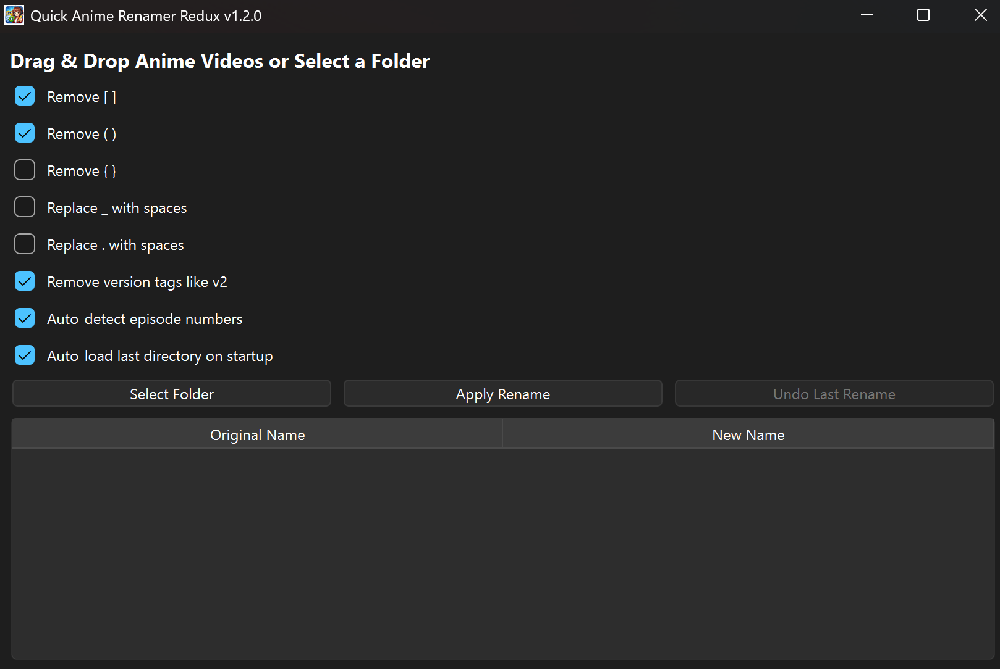

# Quick Anime Renamer Redux



A modern Windows revival of **Quick Anime Renamer**.

## Features
- Drag and drop anime videos
- Folder batch renaming
- Two-column preview
- Smart episode detection
- Removes standalone version tags like `v2` and `v3`
- Auto-load last directory on startup
- Delete key removes files from the current batch
- Filename conflict detection
- Remember window size and position
- Remembers settings
- Native light and dark mode

| Original filename                              | Renamed filename                   |
| ---------------------------------------------- | ---------------------------------- |
| `[Judas] Chained Soldier - S02E06.mkv`         | **Chained Soldier - S02 - 06.mkv** |
| `Jujutsu Kaisen S01E03.mkv`                    | **Jujutsu Kaisen - S01 - 03.mkv**  |
| `[SubsPlease] Yuusha no Kuzu - 06 (1080p).mkv` | **Yuusha no Kuzu - 06.mkv**        |
| `One_Piece_-_1092_[1080p].mkv`                 | **One Piece - 1092.mkv**           |
| `Spirited Away (2001).mkv`                     | **Spirited Away.mkv**              |
| `Show S01E03v2.mkv`                           | **Show - S01 - 03.mkv**            |
| `[Group S01E99] Show S02E01.mkv`               | **Show - S02 - 01.mkv**            |

These examples use the default options. Dots are preserved by default, and
standalone years/resolutions are not automatically removed. For example,
`Akira.1988.1080p.mkv` stays unchanged. If removing an episode token would leave
no title, the original filename is preserved. Check the preview for ambiguous
or multi-episode filenames before applying a batch.

## Credits

Created by **Justin Morland**  
Inspired by the original *Quick Anime Renamer* by **Joshua Park**  
Not affiliated with the original project.

## Build
Build on Windows with Python 3.14.9 or a newer patched 3.14 release.
The project dependencies are isolated in `.venv`; activation is optional.

```powershell
python -m venv .venv
.\.venv\Scripts\python.exe -m pip install --upgrade "pip>=26.2.2"
.\.venv\Scripts\python.exe -m pip install -r requirements-build.txt
.\.venv\Scripts\python.exe -m pip check
.\.venv\Scripts\python.exe -m pip_audit
.\build.ps1
```

To run from source, use `.\.venv\Scripts\python.exe quick_anime_renamer_redux.py`.
`requirements-build.txt` records the installed build and audit environment;
review newer security updates before future releases. Existing EXEs must be
rebuilt to receive Python and dependency updates.

The build script uses a minimal PATH so unrelated installed tools cannot supply
incompatible DLLs to the executable. It restores the original PATH afterward.
